

 

  

**Hi, I'm Qamar 👋 I build clean React interfaces, FastAPI backends that quietly hold them up, and local AI that reads your PDFs.**

👇 This README is a game. Click things.

 


 


  


 

<b>🔍 Curious how DocSense thinks? (click to open the hood)</b>

 

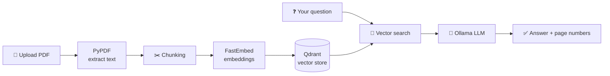

Because it's FastAPI, you also get free interactive docs at `/docs` (Swagger UI) and `/redoc`, so you can upload a file and start asking questions right from the browser.

 


 

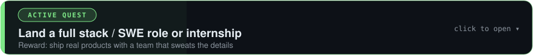

 

I'm looking for a team that cares about both **how things look** and **how they work**. If that's you, the buttons at the bottom of this page are the fastest way to reach me.

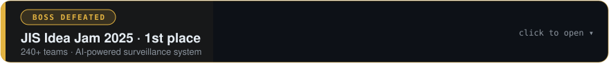

 

Won **1st place at JIS Idea Jam 2025**, out of 240+ teams, with an **AI-powered surveillance system**. It proved to me that a good idea plus a stubborn team goes a long way.

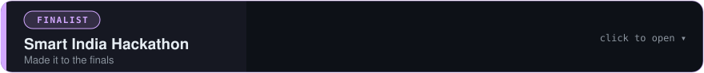

 

Reached the finals of the **Smart India Hackathon**, one of the biggest student hackathons in the country.

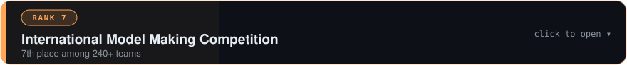

 

Placed **7th** among 240+ teams in an **International Model Making Competition**. Pixels and physical objects both count.

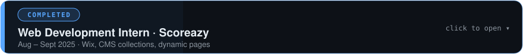

 

**Web Development Intern at Scoreazy (Aug – Sept 2025).** Built and customised responsive websites on Wix, worked with CMS collections, dynamic pages and databases, and worked directly with the founder to turn requirements into live pages.

 


 

<b>🎒 Open the backpack</b>

 

| Slot | Items |
|---|---|
| 🎨 **Frontend** | React · HTML · CSS · Tailwind CSS · JavaScript · Figma |
| ⚙️ **Backend** | FastAPI · REST APIs · Python |
| 🗄️ **Databases** | MySQL · SQLite · SQL · Qdrant (vector) |
| 🤖 **AI / LLM** | Ollama · LangChain · FastEmbed · PyPDF · RAG |
| 🧰 **Tools** | Git · GitHub · Docker · Postman · VS Code |
| 🧠 **Languages** | Python · JavaScript · Java · C++ |
| 📚 **Core skills** | OOP · DBMS · API design · Vector search |

 


 

**Passing through? Leave a message and it shows up right here, automatically.**

You'll need a GitHub account. Your message goes in the issue title, after "Guestbook:".

<!-- GUESTBOOK:START -->
- _Nobody here yet. Be the first to sign!_
<!-- GUESTBOOK:END -->

 


 

<b>Why FastAPI?</b>

 

Type hints in, Swagger docs out. Hard to go back after that.

<b>What are you looking for?</b>

 

A **full stack / software engineer role** or a **tech internship** with people who care about both how things look and how they work.

<b>What's your coding philosophy?</b>

 

> *"Never give up."* — John Cena

Ship it, break it, fix it, ship it better.

<b>🕹️ ↑ ↑ ↓ ↓ ← → ← → B A</b>

 

🎉 **Cheat code accepted!** You've unlocked: *+1 coffee for the dev and a free "hello" from me.* Email me and mention the code.

 

 

**Got a project, a role, or just a cool idea? Pick your message channel:**

 

 


 

<picture>
  <source media="(prefers-color-scheme: dark)" srcset="https://raw.githubusercontent.com/mdqamarhussain/mdqamarhussain/output/github-contribution-grid-snake-dark.svg" />
  <source media="(prefers-color-scheme: light)" srcset="https://raw.githubusercontent.com/mdqamarhussain/mdqamarhussain/output/github-contribution-grid-snake.svg" />
  
</picture>

  

Built with too much ☕ and a little hand-written SVG. Never give up.

