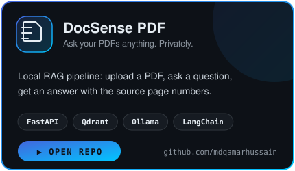
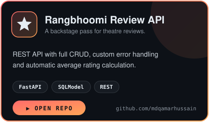
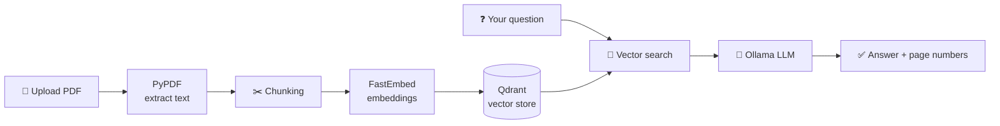
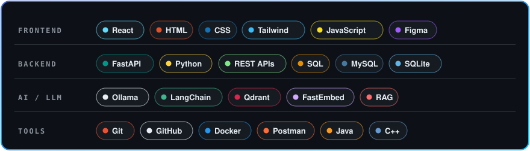

 

  

**I build clean React interfaces, FastAPI backends that quietly hold them up, and local AI that reads your PDFs.**

> 🥇 **Winner, JIS Idea Jam 2025**: 1st place among 240+ teams, with an AI-powered surveillance system.

 

## 🚀 Featured Builds

<b>🔍 How does DocSense work? (click to open)</b>

 

Because it's FastAPI, you also get free interactive docs at `/docs` (Swagger UI) and `/redoc`, so you can upload a file and start asking questions right from the browser.

 

## 🧰 My Skills

 

## ✍️ Guestbook

**Passing through? Leave a message and it shows up right here, automatically.**

You'll need a GitHub account. Your message goes in the issue title, after "Guestbook:".

<!-- GUESTBOOK:START -->
- _Nobody here yet. Be the first to sign!_
<!-- GUESTBOOK:END -->

 

## 🤝 Join the Party

**Got a project, a role, or just a cool idea? Say hi:**

 

 

<picture>
  <source media="(prefers-color-scheme: dark)" srcset="https://raw.githubusercontent.com/mdqamarhussain/mdqamarhussain/output/github-contribution-grid-snake-dark.svg" />
  <source media="(prefers-color-scheme: light)" srcset="https://raw.githubusercontent.com/mdqamarhussain/mdqamarhussain/output/github-contribution-grid-snake.svg" />
  
</picture>

  

My APIs come with Swagger docs. My swagger comes naturally. 😎

