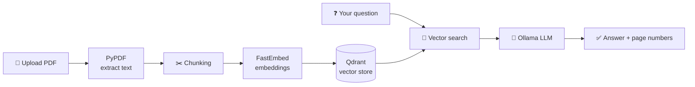

 

  

**Hi, I'm Qamar 👋 I make interfaces people enjoy, backends that quietly hold them up, and the occasional AI that reads your PDFs.**

👇 This README is a game. Click things.

 

## 🎮 Player One

|  |  |
|---|---|
| 🧙 **Class** | Full Stack Developer (frontend flair, backend brains) |
| 📍 **Spawn point** | Andal, West Bengal, India |
| 🏰 **Guild** | [Falqom](https://github.com/mdqamarhussain) · Web Developer |
| 🎓 **Training** | B.Tech CSE · Asansol Engineering College · Class of 2026 |
| ⚔️ **Main weapons** | React · FastAPI · Python · SQL |
| 🧪 **Side hobby** | Local LLMs and RAG pipelines |
| 🎯 **Current quest** | Landing a full stack / SWE role or internship |

 

## 🔥 Featured Builds

 

**🧠 DocSense PDF** lets you upload a PDF and ask it questions, with answers that cite the page they came from. It runs fully on your own machine, so your documents never leave it.
**🎭 Rangbhoomi Review API** is a backstage pass for theatre reviews: full CRUD, custom error handling and automatic average ratings.

<b>🔍 Curious how DocSense thinks? (click to open the hood)</b>

 

Because it's FastAPI, you also get free interactive docs at `/docs` (Swagger UI) and `/redoc`, so you can upload a file and start asking questions right from the browser.

 

## 📜 Quest Log

🔥 <b>ACTIVE QUEST</b> · Build for real businesses (Falqom, Jan 2026 → now)

 

- Design and ship responsive websites and digital solutions for local businesses
- Clients so far include **Andal Model School** and **Ayyubi Fragrances**
- Part of a 4-person team that designs, builds and deploys every project together

✅ <b>COMPLETED</b> · Web Development Intern (Scoreazy, Aug–Sept 2025)

 

- Built and customised responsive sites on Wix
- Worked with CMS collections, dynamic pages and databases
- Worked directly with the founder to turn requirements into live pages

🏆 <b>BOSS DEFEATED</b> · JIS Idea Jam 2025 (1st place, 240+ teams)

 

Won with an **AI-powered surveillance system**. It's the project that proved to me that a good idea plus a stubborn team goes a long way.

🏅 <b>SIDE QUESTS</b> · More loot

 

- 🏅 **Smart India Hackathon**: finalist
- 🛠️ **International Model Making Competition**: 7th place among 240+ teams

 

## 🎒 Inventory

<b>Open the backpack</b>

 

| Slot | Items |
|---|---|
| 🎨 **Frontend** | React · HTML · CSS · Tailwind CSS · JavaScript · Figma |
| ⚙️ **Backend** | FastAPI · REST APIs · Python |
| 🗄️ **Databases** | MySQL · SQLite · SQL · Qdrant (vector) |
| 🤖 **AI / LLM** | Ollama · LangChain · FastEmbed · PyPDF · RAG |
| 🧰 **Tools** | Git · GitHub · Docker · Postman · VS Code |
| 🧠 **Languages** | Python · JavaScript · Java · C++ |
| 📚 **Core skills** | OOP · DBMS · API design · Vector search |

 

## 💬 FAQ (Frequently Asked by Nobody)

<b>Why FastAPI?</b>

 

Type hints in, Swagger docs out. Hard to go back after that.

<b>What are you looking for?</b>

 

A **full stack / software engineer role** or a **tech internship** with people who care about both how things look and how they work.

<b>What's your coding philosophy?</b>

 

> *"Never give up."* — John Cena

Ship it, break it, fix it, ship it better.

<b>🕹️ ↑ ↑ ↓ ↓ ← → ← → B A</b>

 

🎉 **Cheat code accepted!** You've unlocked: *+1 coffee for the dev and a free "hello" from me.* Email me and mention the code.

 

## 📊 Player Stats

<b>Peek at my GitHub numbers</b>

 

 

## 🤝 Join My Party

**Got a project, a role, or just a cool idea? Pick your message channel:**

 

  

Built with too much ☕ and a little hand-written SVG.

